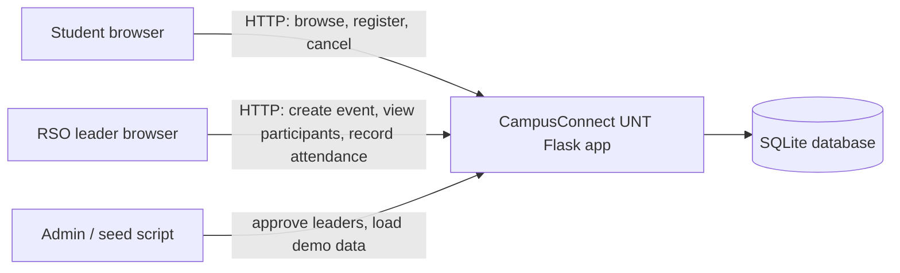
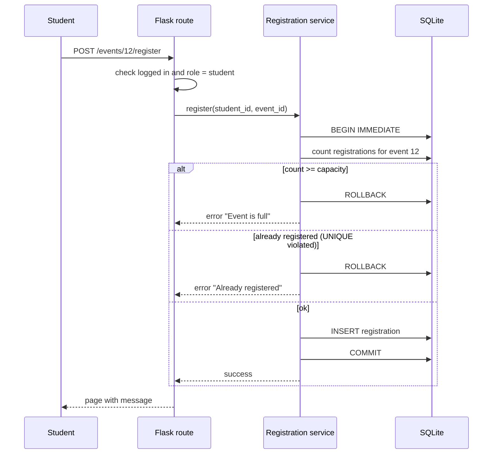
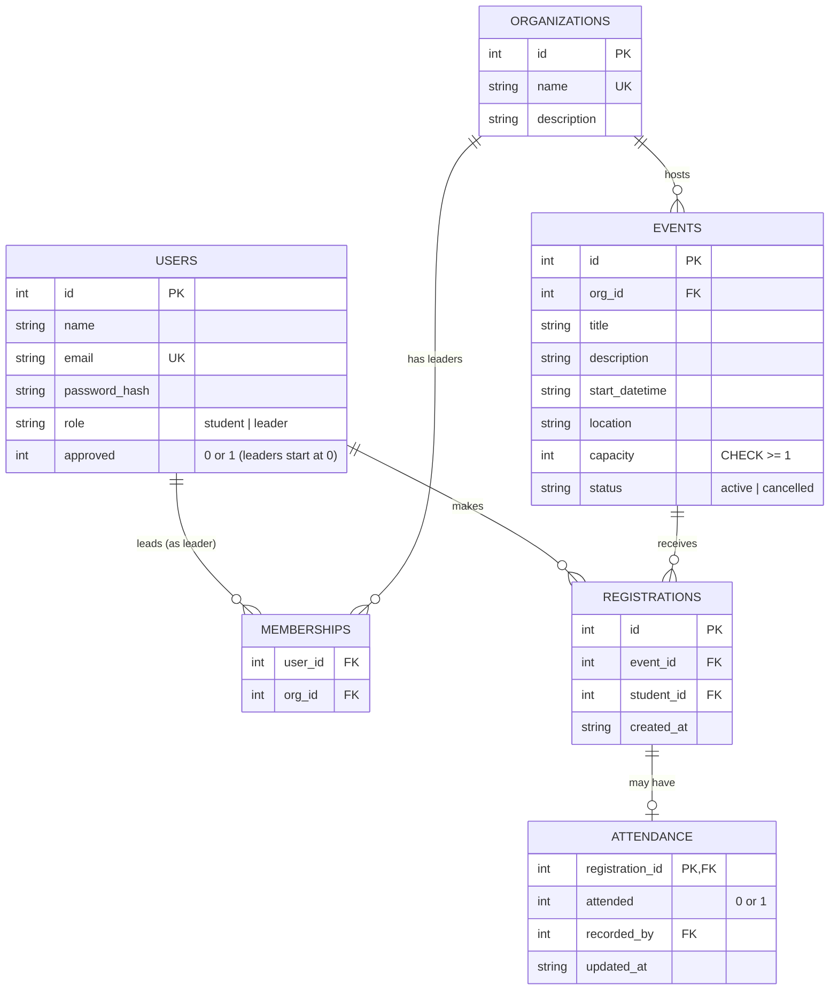

# Full Spec: CampusConnect UNT

**Team:** Emmanuel Dickson, Aeshwa Kachhadiya, Kavya Balaji Singh, Darshil Amit Soni, Jacob Tandoh  **Date:** Nov 19, 2026  **Committer:** Emmanuel Dickson

**Roles:** Product Owner Emmanuel Dickson | Process lead Aeshwa Kachhadiya | Architect Jacob Tandoh | Quality lead Kavya Balaji Singh | Prompt engineer Darshil Amit Soni

---

## 0. The idea (Chapter 1)
- **Main problem, and for whom:** UNT students have no single, simple place to discover and register for Registered Student Organization (RSO) events, and RSO leaders have no simple way to publish events, manage sign-ups, and record who actually attended.
- **Who is harmed if this app fails, is wrong, or leaks data?**
  - Students: their names, emails, and event participation could be exposed. A silently lost registration means they show up to an event they think they have a spot in.
  - RSO leaders: wrong capacity or attendance numbers mislead their planning and reporting.
  - Other organizations: a leader who can see another RSO's attendance would be a privacy breach.
- **The app must never:**
  - Store plain-text passwords.
  - Let a student reach leader-only functions.
  - Let a leader see or change another RSO's registrations or attendance.
  - Allow more registrations than an event's capacity.
  - Use real student data (demo data is fictional and UNT-themed).

## 1. Process and plan (Chapters 2 and 3)  Owner: Aeshwa Kachhadiya
- **Process model:** Incremental delivery with agile practices. The requirements are small and fairly stable, but registration rules and authorization are risky, so we build and test the riskiest workflow (event, register, capacity) first and add the rest in later increments, instead of one big plan-driven build.
- **Practices we actually use:** GitHub board with issues, short weekly stand-up, one-week sprints, pull-request code review (one approval), automated tests on every change, a short retrospective at each sprint end.
- **Definition of Done** (a feature is done only when all are true):
  - [ ] Code is merged to `main` through a pull request with at least one approval.
  - [ ] `uv run pytest` passes, including tests for the feature's Must-do requirement.
  - [ ] Inputs are validated and failures show a clear error message.
  - [ ] The feature works for the correct role only (students and leaders cannot use each other's functions).
  - [ ] Works on a phone-width screen and by keyboard alone.
  - [ ] README steps still work on a clean setup.
- **Deployment decision:** Runs **locally** (`flask run`) with fictional demo data. No hosting, which satisfies the "free tools only" constraint. Hosting is out of scope unless time remains.

| Sprint | Working software at the end | se-agent run? |
|---|---|---|
| 1 (Nov 19 to Nov 25) | Accounts, login/logout, roles, leader authorization, database schema, demo data seeding | Yes (run 1) |
| 2 (Nov 26 to Dec 2) | Leaders create events; students browse and search; register with duplicate and capacity enforcement; view and cancel registrations | Yes (run 2) |
| 3 (Dec 3 to Dec 9) | Leader views participants, records attendance; registration and attendance totals; accessibility pass; README. Should-dos only if time allows | Yes (run 3) |

- **Biggest schedule risk and response:** Registration integrity and authorization take longer than expected. Response: they are built first (sprints 1 and 2), tests are written before or with the code, and all Should-dos are dropped before any Must-do is cut.
- **Timeline:** Three one-week sprints: Sprint 1 Nov 19 to Nov 25, Sprint 2 Nov 26 to Dec 2, Sprint 3 Dec 3 to Dec 9. This answers open question 3 from the brief.
- **AI contribution:** AI drafted this section from the Project Brief and the professor's feedback. The team reviewed it and made no changes.

## 2. Requirements (Chapter 4)  Owner (Product Owner): Emmanuel Dickson
**Stakeholders and what each wants:**

| Stakeholder | Wants |
|---|---|
| UNT students | Find events fast on a phone or computer, register in a few steps, cancel easily, trust that their spot is real |
| RSO leaders | Publish events, know who registered, record attendance, see accurate totals |
| Course instructor / graders | A traceable spec, justified decisions, tests that can fail, safe handling of data |
| UNT / RSO advisors (indirect) | Student privacy protected; no impersonation of an official system |
| Development team | A scope small enough to finish and test |

**User stories** (each with acceptance criteria):
1. As a student, I want to create an account and log in, so that I can register for events.
   - Accept: valid sign-up succeeds; duplicate email is rejected; wrong password shows an error; logout ends the session.
2. As an RSO leader, I want to create an event with title, description, date, time, location, and capacity, so that students can find and join it.
   - Accept: the event appears in the listing; a missing field or capacity below 1 is rejected.
3. As a student, I want to search upcoming events by event title or RSO name, so that I can quickly find relevant ones.
   - Accept: a search for "career" returns matching upcoming events only; no match shows "no events found".
4. As a student, I want to register for an event, so that I have a spot.
   - Accept: first registration succeeds; a second attempt shows a duplicate error; a registration on a full event shows a capacity error.
5. As a student, I want to view and cancel my registrations, so that I can free my spot if I cannot attend.
   - Accept: cancelling removes it from my list and the spot becomes available to another student.
6. As an RSO leader, I want to see who registered and record who attended, so that I can track engagement.
   - Accept: only the leader of that RSO sees the list; attendance can only be marked for registered students.
7. As an RSO leader, I want registration and attendance totals per event, so that I can judge turnout.
   - Accept: totals match the underlying records after registrations, cancellations, and attendance changes.

**Requirements table**

| ID | Type | Requirement (one testable sentence) | Priority | Acceptance test (input -> expected result) |
|---|---|---|---|---|
| R1 | F | A visitor can create a student or leader-pending account with a unique email and a password of at least 8 characters. | Must | Valid sign-up -> account created, password stored hashed; duplicate email -> error, no new account. |
| R2 | F | A user can log in and log out, and logged-out users cannot open protected pages. | Must | Correct credentials -> session starts; wrong password -> error; after logout, visiting `/my-registrations` redirects to login. |
| R3 | F | The system enforces roles: only an approved RSO leader can use leader functions, and only for RSOs they manage. | Must | Student requests the create-event page -> 403; leader of RSO A opens attendance for an RSO B event -> 403. |
| R4 | F | An approved leader can create an event with title, description, date, time, campus location, and capacity of at least 1. | Must | All fields valid -> event listed; capacity 0 or blank title -> validation error. |
| R5 | F | A logged-in user can view upcoming events and search by event title or RSO name. | Must | Search "Data Science Club" -> only that RSO's events; past events are not shown. |
| R6 | F | A student can register for an event at most once and never beyond its capacity, including when two requests arrive at the same time. | Must | Register twice -> second rejected; capacity 1 with two simultaneous requests -> exactly one succeeds. |
| R7 | F | A student can view their registrations and cancel one, which frees a spot immediately. | Must | Cancel -> removed from list, registered count drops by 1, another student can now register. |
| R8 | F | A leader can view the participants of their own events and mark each registered participant as attended or not attended. | Must | Mark attended -> saved; mark a non-registered student -> rejected. |
| R9 | F | The event page shows the registered count and attended count, matching the database. | Must | 3 registered, 2 attended -> page shows 3 and 2; after one cancellation -> shows 2 registered. |
| R10 | NF (performance) | Event listing and search respond in under 1 second with up to 500 events and 5,000 registrations on a normal laptop. | Should | Seed that data, time the request in a test -> under 1 s. |
| R11 | NF (usability / accessibility) | All forms have labels, pages work by keyboard only, and the layout is usable at 360 px width. | Must | Tab through the register flow without a mouse; run an accessibility checker on the main pages -> no critical errors. |
| R12 | NF (security / privacy) | Passwords are hashed, session cookies are protected, all form inputs are validated, and attendance data is visible only to the owning RSO's leaders. | Must | Inspect database -> no plain text passwords; student requests attendance data -> 403. |
| R13 | NF (cost) | The app uses only free, open-source tools and no paid APIs or hosting. | Must | Dependency list contains only open-source packages; app runs with no API keys. |

**Out of scope:**
- Integration with official UNT login systems, UNT Engage, or university event systems.
- Official RSO event approvals and Talons Up point awards.
- Payment processing and ticket sales.
- AI-powered event recommendations.
- Native Android or iOS apps.
- Real student data; hosting online (unless added later).
- Scheduling-conflict detection between events (see open questions).

**Requirements we removed as unnecessary, and why:**
- The brief's single "create accounts, log in, log out" requirement was **split** into R1, R2, and R3 because the feedback said it combined several operations.

**Open questions and how we resolved them** (owner in brackets):
- Can a leader manage more than one RSO, and can an RSO have several leaders? Decision: yes to both, through a `memberships` table. [Architect]
- Can attendance be corrected after it is recorded? Decision: yes, by the owning leader, with an `updated_at` timestamp. [Product Owner]
- What happens to registrations when a leader cancels an event? Decision: event status becomes `cancelled`; registrations are kept; attendance cannot be recorded. [Product Owner]
- Should the app detect when a student registers for two events at the same time? Decision: not in this version; listed as a Should/future item. [Product Owner]
- Exact sprint dates. Decision: three one-week sprints (see section 1). [Process lead]

**Check:** We replaced vague words with observable ones (for example "fast" became "under 1 second with 500 events"; "secure" became hashed passwords, role checks, and 403 responses).
- **AI contribution:** AI split the brief's requirements, wrote the first draft of the stories and tests, and proposed the open-question answers. The team reviewed it and made no changes.

## 3. Models (Chapter 5)  Owner (Architect): Jacob Tandoh

**Context model**
- **Inside the system:** Flask web app (pages and routes), business logic, SQLite database.
- **Outside the system (actors):** Student (browser), RSO leader (browser), a system administrator who seeds demo data and approves leaders (see D1).
- **Crossing the boundary:** HTTP requests and responses (forms, page views), session cookie, demo data seed script.
- **Explicitly outside:** UNT login, UNT Engage, email or SMS services, payment systems.

**Use cases / sequence model for the most important story (register for an event)**

Use cases: Student: sign up, log in, browse and search, register, view registrations, cancel. Leader: log in, create event, view participants, record attendance, view totals.

**Class / data model** (relational)

Rules in the data model:
- `REGISTRATIONS` has `UNIQUE(event_id, student_id)`, which blocks duplicates at the database level.
- A leader is a `USERS` row with `role = leader` linked to one or more organizations through `MEMBERSHIPS`; an organization may have several leaders.
- Attendance is tied to a registration, so attendance can only exist for a registered student.
- Capacity is enforced in the registration transaction (see section 4, D3).

**State model:**
- Event: `active` -> `cancelled`. In `cancelled` state, no new registrations or attendance changes.
- Leader account: `pending` -> `approved`. A pending leader cannot use leader functions (see D1).
- No other modes.

**Consistency check:**
- Requirement R3 (roles) appeared in no model at first. We resolved it by adding `MEMBERSHIPS` and the `role`/`approved` fields to the data model.
- The state model's "cancelled event" has no requirement. We resolved it by adding the cancelled-event open question and edge-case tests (section 6).
- **AI contribution:** AI drafted the diagrams and rules. The team reviewed it and made no changes.

## 4. Architecture (Chapter 6)  Owner (Architect): Jacob Tandoh
- **Pattern we chose:** Layered monolith inside one Flask app: routes (presentation) -> service layer (business rules) -> data access (SQL) -> SQLite. Server-rendered pages with light JavaScript.
- **Non-functional requirements that drove it:** R6 (integrity) and R12 (security) drove the service layer and database constraints. R11 (usability) drove server-rendered semantic HTML. R13 (cost) drove SQLite and local running. R10 (performance) is easy at this size and drove nothing special.
- **Alternatives we rejected, and why:**
  - Separate JavaScript front end with a REST API: more moving parts and more to test, with no requirement that needs it.
  - PostgreSQL or a hosted database: breaks R13 (free, no hosting) and adds setup work.
  - Doing all checks in JavaScript on the page: cannot be trusted for R3 and R6.
- **AI use in the app:** None. The app has no AI feature, so there is no model fallback or per-use cost. (AI is only used to help write code through se-agent.)

**Authentication and authorization design (professor's highest-priority item)**
- **Roles:** `student` and `leader`. Permissions:

| Action | Visitor | Student | Leader (own RSO) | Leader (other RSO) |
|---|---|---|---|---|
| Sign up / log in | Yes | n/a | n/a | n/a |
| Browse / search events | No (login required) | Yes | Yes | Yes |
| Register / cancel own registration | No | Yes | No | No |
| Create / edit event | No | No | Yes | No |
| View participants and totals | No | No | Yes | No |
| Record or correct attendance | No | No | Yes | No |

- **How an account becomes an RSO leader:** Choosing "leader" at sign-up only creates a **pending** leader request. It is **not** trusted. A leader gets privileges only when an administrator (or the seed script, for demo data) approves the account and links it to an organization in `memberships`. This avoids the problem the feedback warned about. Because official UNT verification is out of scope, this simulates what the university would do.
- **Preventing students from reaching leader functions:** every leader route goes through a server-side `@leader_required` check, and any route touching an event also checks that the user is a member of the event's `org_id`. Returns 403 otherwise. Hiding buttons in the page is only cosmetic.
- **Passwords and sessions:** passwords hashed with a salted algorithm (Werkzeug `generate_password_hash`); Flask signed session cookies with `HttpOnly` and `SameSite=Lax`; secret key from an environment variable, never committed; CSRF token on all POST forms; session ends on logout.

**Registration integrity design (professor's second priority item)**
- Duplicate prevention: `UNIQUE(event_id, student_id)` in the database.
- Capacity: registration runs in a SQLite `BEGIN IMMEDIATE` transaction that counts current registrations and inserts only if `count < capacity`. SQLite allows one writer at a time, so two simultaneous "last seat" requests cannot both succeed.
- Cancellation: deleting the registration (and its attendance row) frees the spot immediately; cancellation is not allowed after the event has started.
- Proof: a test runs two registrations in parallel against capacity 1 and asserts exactly one wins (section 6).

**Decisions log**

| # | Decision | Alternatives | Reason (tie to an R-number) | Consequence |
|---|---|---|---|---|
| D1 | Leader accounts start pending and are approved by an admin/seed script | Trust the "leader" choice at sign-up; invite code | R3, R12: self-selected roles would let anyone see attendance data | Needs a small admin approval step and demo seed data |
| D2 | Layered Flask monolith with server-rendered pages | SPA plus REST API | R11, R13: fewer parts to test and keep accessible | Less dynamic UI; page reloads on actions |
| D3 | Enforce capacity and duplicates in the database transaction plus UNIQUE constraint | Check only in Python code before insert | R6: a check-then-insert in code can race | SQLite write lock serializes registrations; fine at this scale |
| D4 | SQLite with a local run, no hosting | Hosted PostgreSQL | R13: free, simple setup | Not usable by real users online; deployment is future work |
| D5 | Attendance stored per registration, correctable by the owning leader | Free-standing attendance list | R8, R9: totals stay consistent with registrations | Cancelling a registration also deletes its attendance row |

- **AI contribution:** AI proposed D1 to D5 and the transaction design. The team reviewed it and made no changes.

## 5. Design and implementation (Chapter 7)  Owner: Darshil Amit Soni
- **Modules, and the owner of each:**

| Module | Owner | Responsibility |
|---|---|---|
| `app/__init__.py`, `config.py` | Emmanuel Dickson | Flask app factory, configuration, secret key from environment |
| `app/db.py`, `schema.sql`, `seed.py` | Jacob Tandoh | Connection handling, schema with constraints, fictional UNT-themed demo data |
| `app/auth.py` | Aeshwa Kachhadiya | Sign-up, login, logout, password hashing, `@login_required`, `@leader_required`, org-membership check |
| `app/events.py` (routes) + `services/event_service.py` | Emmanuel Dickson | Create events, list and search upcoming events |
| `services/registration_service.py` | Darshil Amit Soni | Register, cancel, capacity and duplicate rules (transactional) |
| `services/attendance_service.py` | Kavya Balaji Singh | Record and correct attendance, compute totals |
| `templates/`, `static/` | Darshil Amit Soni | Accessible HTML, CSS, small JavaScript |
| `tests/` | Kavya Balaji Singh | Unit, component, and system tests |

- **Where the logic lives apart from the display:** in `services/`. Services take plain arguments (user id, event id) and return results or raise validation errors, so they can be unit-tested without a browser. Routes only translate HTTP to service calls.
- **Design patterns:** Application factory (Flask), service layer, decorators for access control. Others: none yet.
- **Code or libraries to reuse, with licenses:** Flask (BSD-3-Clause), Werkzeug (BSD-3-Clause), Jinja2 (BSD-3-Clause), pytest (MIT), Flask-WTF for CSRF (BSD-3-Clause). SQLite is public domain. The final list lives in the repo's requirements file.
- **Branching and review rule:** feature branches, pull request into `main`, one approval from a teammate who did not write it, `uv run pytest` green before merge, AI-generated code is reviewed like any other code (the reviewer must be able to explain it).
- **Technical debt we are knowingly accepting:** no hosting or production server; no email verification; no password reset; simple admin approval (script or tiny admin page); no scheduling-conflict detection.
- **AI contribution:** AI proposed the module split. The team reviewed it and made no changes.

## 6. Testing (Chapter 8)  Owner (Quality lead): Kavya Balaji Singh
**Requirement-to-test map**

| Requirement | Test (file::name) | Type | How we will check it can fail |
|---|---|---|---|
| R1 | `tests/test_auth.py::test_signup_hashes_password`, `::test_duplicate_email_rejected` | unit / component | Temporarily store the raw password; test must fail |
| R2 | `tests/test_auth.py::test_login_logout`, `::test_protected_page_requires_login` | component | Remove `@login_required`; test must fail |
| R3 | `tests/test_permissions.py::test_student_cannot_create_event`, `::test_leader_cannot_access_other_rsos_attendance`, `::test_pending_leader_has_no_privileges` | component | Remove the org-membership check; test must fail |
| R4 | `tests/test_events.py::test_create_event_valid`, `::test_capacity_below_one_rejected` | unit | Remove the capacity validation; test must fail |
| R5 | `tests/test_events.py::test_search_by_title_and_rso`, `::test_past_events_hidden` | unit | Break the search filter; test must fail |
| R6 | `tests/test_registration.py::test_duplicate_registration_rejected`, `::test_capacity_never_exceeded`, `::test_two_simultaneous_requests_last_seat` | unit / component | Remove the UNIQUE constraint or the transaction; tests must fail |
| R7 | `tests/test_registration.py::test_cancel_frees_spot` | component | Skip the delete on cancel; test must fail |
| R8 | `tests/test_attendance.py::test_mark_attendance_registered_only`, `::test_attendance_correction` | component | Allow unregistered students; test must fail |
| R9 | `tests/test_attendance.py::test_totals_match_records` | system | Hard-code a total; test must fail |
| R11 | `tests/test_pages.py::test_forms_have_labels` (+ manual keyboard check) | system / user | Remove a label; test must fail |
| R12 | `tests/test_auth.py::test_no_plaintext_passwords`, `::test_csrf_required` | component | Disable hashing/CSRF; test must fail |

**The three most important tests, in plain language:**
1. Capacity 1, two students register at the same moment -> exactly one succeeds, the other gets a "full" error, and the database holds one registration.
2. A student (or a leader of a different RSO) asks for an event's participant list or attendance page -> access denied (403), no data returned.
3. Student registers, cancels, and a second student registers for the freed spot -> the second registration succeeds and the registered count stays at the capacity or below.

- **Edge cases we will try to break each Must-do with:** capacity 0, negative, or huge (1,000,000); empty title or description; past dates; very long text; duplicate emails with different capitalization; empty search; registering for a cancelled or already-started event; marking attendance for a student who cancelled; two leaders editing attendance at once; SQL-like text in search fields.
- **User testing:** 3 to 5 classmates outside the team (at least one on a phone, one using keyboard only). We want to learn whether they can find, register for, and cancel an event without help, and whether the forms and error messages are clear. Planned for sprint 3 (Dec 3 to Dec 9).
- **Deliberately not testing:** visual styling details; performance beyond the R10 check; real UNT data or login; load with many real concurrent users (SQLite single-machine demo scope).
- **Test command:** `uv run pytest`
- **AI contribution:** AI drafted the test list and "how it can fail" checks. The team reviewed it and made no changes.

## 7. Evolution (Chapter 9)  Owner: Aeshwa Kachhadiya
- **Most likely future change:** deploy online and replace our own accounts with UNT login (or at least add email verification), plus add reminders for registered events.
- **Impact analysis:**
  - Modules: `auth.py` (login method), `config.py` and `db.py` (hosted database), possibly a new reminder/notification module.
  - Models: context model gains an external login provider; data model gains `external_id` or `email_verified`.
  - Requirements: R1, R2, R3, R12, R13 change (cost and hosting).
  - Tests: auth and permission tests change; registration, attendance, and event tests should stay the same.
  - Rough time: about 1 to 2 weeks for the login change and hosting; about 3 to 5 days for reminders. These estimates are rough.
- **Design choice today that makes it easier:** keep all authentication behind `auth.py` and `@login_required`/`@leader_required`, keep all SQL in the data layer so a database swap touches one place, and read the database path and secret key from configuration.
- **AI contribution:** AI proposed the change and estimates. The team reviewed it and made no changes.

## 8. Decisions we are least sure about
(Prepare to be asked about these.)
- D1: Is admin approval of leaders realistic for a student project, or is an invite code per RSO simpler and still safe enough?
- D3: Does SQLite's single-writer transaction truly prevent overselling in our Flask setup, and do our concurrency tests really prove it (threads vs real parallel processes)?
- Whether a leader may correct attendance forever, or only for a limited time after the event.
- Whether one registration table with deletion on cancel loses useful history (a `status` column might be better).
- Local-only deployment: is it enough to demonstrate the project?

## 9. Run plan and cost (se-agent)  Owner (Prompt engineer): Darshil Amit Soni
- **Prompts in `prompts/` we will use, in order:**
  1. `prompts/CH5_System_Modeling.md`: system models (context, use case, sequence, class, state) from the Run Brief.
  2. `prompts/CH6_Architectural_Design.md`: architecture record (layered Flask monolith, module decomposition).
  3. `prompts/CH7_OO_Detailed_Design.md`: detailed class and interface design for auth, events, registration, and attendance.
  4. `prompts/CH8-9_Testing_and_Evolution.md`: test plan (duplicates, capacity, last seat, role checks) and evolution plan.

  The router picks which prompt runs at each step from its Role and Task, so this is our intended order, not a fixed sequence.
- **Model:** `gpt-6-luna` for iteration; ask before using a stronger one.
- **Planned runs (default: one per sprint):**

| Run | Sprint | Prompts (focus) | Model | Estimated cost (`uv run python cost_estimate.py docs/RUN_BRIEF.md`) |
|---|---|---|---|---|
| 1 | 1 | CH5, CH6 | gpt-6-luna | $0.02 typical (range $0.01 to $0.05) |
| 2 | 2 | CH7 | gpt-6-luna | $0.02 typical (range $0.01 to $0.05) |
| 3 | 3 | CH8-9 | gpt-6-luna | $0.02 typical (range $0.01 to $0.05) |

- **Cost estimate details:** 4 prompt files (about 4,811 tokens each) plus the Run Brief (about 1,077 tokens). One full run is about 138,000 tokens in the typical case (6 steps), 69,000 light (4 steps), 280,000 heavy (8 steps). Total for three runs: about $0.06 typical, $0.15 at most. Prices as of 2026-10-20 from `prices.json`. After each real run we will record the actual usage with `--measured-in` / `--measured-out`.
- **Before we request a run, we confirmed:**
  - [x] `uv run pytest` passes (143 passed, Nov 19, 2026).
  - [x] Run Brief is 4,000 characters or fewer (3,769).
  - [x] Each prompt follows the 8-section template (Role, Context, Task/Objective, Requirements, Constraints, Process, Output Format, Verification).
- **How AI-generated code is reviewed:** a teammate reads every diff, runs the tests, and checks the permission and capacity rules by hand before merging.

## 10. Run Brief
The Run Brief is a **separate file**: `docs/RUN_BRIEF.md`.

- **Characters in our Run Brief:** 3,769 (limit is 4,000)
- **What we cut to fit, and why it was safe to cut:** process reasoning, stakeholder table, diagrams, the decision log, and long rationale. The agents only need the Must-dos, constraints, quality rules, and acceptance checks, which are all kept in words.

## 11. Presentation notes (six beats; every member speaks)

| Beat | Who | One sentence we will say |
|---|---|---|
| 1. Problem, user, Must-dos (Ch 4) | Emmanuel Dickson | UNT students cannot easily find and sign up for RSO events, so CampusConnect lets leaders publish events and students register, with nine testable Must-dos. |
| 2. Process choice and Definition of Done (Ch 2, 3) | Aeshwa Kachhadiya | We build incrementally in three sprints, riskiest workflow first, and a feature is done only when reviewed, tested, role-checked, and accessible. |
| 3. Context model and one more model (Ch 5) | Emmanuel Dickson | The context model shows students, leaders, and an admin talking to one Flask app and SQLite, and the ER model shows how users, RSOs, events, registrations, and attendance relate. |
| 4. One architecture decision: chosen, rejected, which requirement forced it (Ch 6) | Jacob Tandoh | We enforce capacity and duplicates in a database transaction instead of only in Python, because R6 requires that two students can never take the last seat. |
| 5. Three most important tests, and how we know they can fail (Ch 8) | Kavya Balaji Singh | Last-seat race, access denial for wrong roles, and cancel-then-reregister, and we prove each can fail by removing the rule they protect. |
| 6. Likely change, Run Brief, cost plan (Ch 9, 4) | Darshil Amit Soni | The likely change is hosting plus UNT login, which only touches the auth and config modules, and our three se-agent runs on gpt-6-luna are costed in section 9. |
