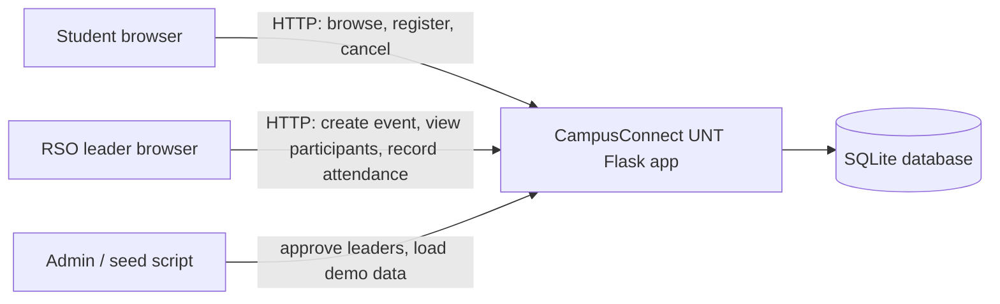
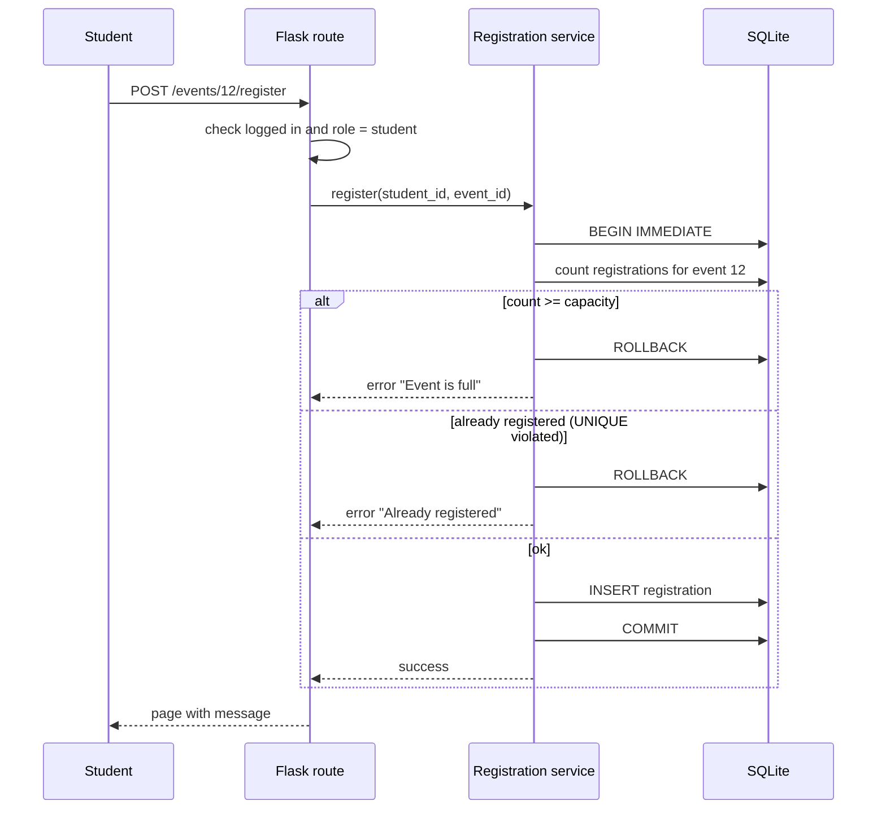
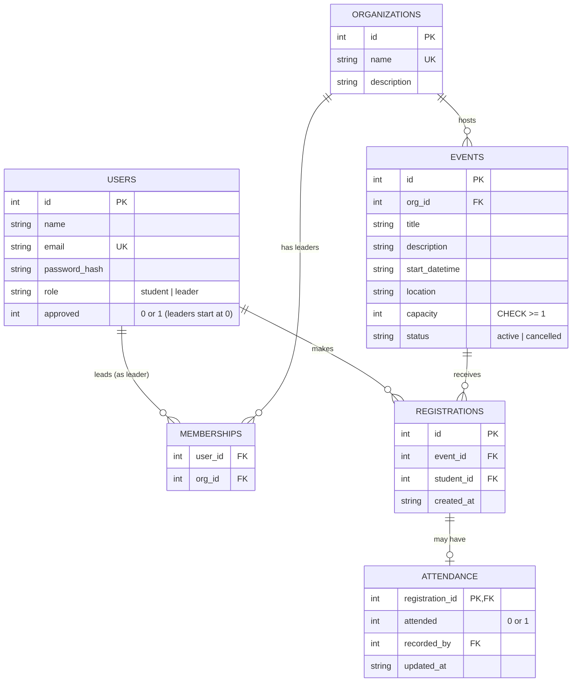

# Full Spec: CampusConnect UNT

**Team:** Emmanuel Dickson, Aeshwa Kachhadiya, Kavya Balaji Singh, Darshil Amit Soni, Jacob Tandoh  **Date:** Nov 19, 2026  **Committer:** Jacob Kplorla Tandoh

**Roles:** Product Owner Emmanuel Dickson | Process lead Aeshwa Kachhadiya | Architect Jacob Tandoh | Quality lead Kavya Balaji Singh | Prompt engineer Darshil Amit Soni

---

## 0. The idea (Chapter 1)
- **Main problem, and for whom:** There is no one easy place where UNT students can find Registered Student Organization (RSO) events and sign up for them. RSO leaders also lack a simple tool for posting events, handling sign-ups, and keeping track of who showed up.
- **Who is harmed if this app fails, is wrong, or leaks data?**
  - Students: a leak could reveal their names, emails, and which events they attend. If a registration is lost without warning, a student may arrive expecting a spot that does not exist.
  - RSO leaders: incorrect capacity or attendance figures throw off their planning and reports.
  - Other organizations: if one leader could view another RSO's attendance, that would be a privacy violation.
- **The app must never:**
  - Save passwords in plain text.
  - Give a student access to functions meant only for leaders.
  - Allow a leader to view or edit registrations or attendance belonging to a different RSO.
  - Accept more registrations than an event can hold.
  - Contain real student data (all demo data is made up and UNT-themed).

## 1. Process and plan (Chapters 2 and 3)  Owner: Aeshwa Kachhadiya
- **Process model:** Incremental delivery using agile practices. Our requirements are few and fairly stable, but the registration rules and authorization carry the most risk. So instead of one large plan-driven build, we first build and test the riskiest workflow (event, register, capacity) and then add the remaining features in later increments.
- **Practices we actually use:** a GitHub board with issues, a brief weekly stand-up, one-week sprints, code review through pull requests (one approval needed), automated tests on every change, and a quick retrospective at the end of each sprint.
- **Definition of Done** (a feature counts as done only when every item is true):
  - [ ] The code reaches `main` through a pull request approved by at least one person.
  - [ ] `uv run pytest` passes, and this includes tests for the feature's Must-do requirement.
  - [ ] Inputs are validated, and any failure shows a clear error message.
  - [ ] Only the correct role can use the feature (students and leaders cannot use each other's functions).
  - [ ] It works on a phone-sized screen and with the keyboard alone.
  - [ ] The README steps still work on a fresh setup.
- **Deployment decision:** The app runs **locally** (`flask run`) using fictional demo data. There is no hosting, which keeps us within the "free tools only" constraint. Hosting is out of scope unless we have time left over.

| Sprint | Working software at the end | se-agent run? |
|---|---|---|
| 1 (Nov 19 to Nov 25) | Accounts, login/logout, roles, leader authorization, database schema, demo data seeding | Yes (run 1) |
| 2 (Nov 26 to Dec 2) | Leaders create events; students browse and search; registration with duplicate and capacity checks; students view and cancel registrations | Yes (run 2) |
| 3 (Dec 3 to Dec 9) | Leaders view participants and record attendance; registration and attendance totals; accessibility review; README. Should-dos only if time permits | Yes (run 3) |

- **Biggest schedule risk and response:** Registration integrity and authorization could take longer than planned. To handle this, we build them first (sprints 1 and 2), write their tests before or alongside the code, and drop every Should-do before cutting any Must-do.
- **Timeline:** Three sprints of one week each: Sprint 1 Nov 19 to Nov 25, Sprint 2 Nov 26 to Dec 2, Sprint 3 Dec 3 to Dec 9. This settles open question 3 from the brief.
- **AI contribution:** AI wrote the first draft of this section from the Project Brief and the professor's feedback, and later reworded it. The team reviewed it and made no content changes.

## 2. Requirements (Chapter 4)  Owner (Product Owner): Emmanuel Dickson
**Stakeholders and what each wants:**

| Stakeholder | Wants |
|---|---|
| UNT students | Quickly find events on a phone or computer, sign up in a few steps, cancel without hassle, and be sure their spot is real |
| RSO leaders | Post events, see who signed up, take attendance, and view accurate totals |
| Course instructor / graders | A traceable spec, decisions with reasons, tests that are able to fail, and careful handling of data |
| UNT / RSO advisors (indirect) | Protection of student privacy; no imitation of an official university system |
| Development team | A scope small enough to complete and test |

**User stories** (each with acceptance criteria):
1. As a student, I want to sign up and log in, so that I can register for events.
   - Accept: a valid sign-up works; a repeated email is refused; a wrong password shows an error; logging out ends the session.
2. As an RSO leader, I want to create an event with a title, description, date, time, location, and capacity, so that students can find it and join.
   - Accept: the event shows up in the listing; a missing field or a capacity under 1 is refused.
3. As a student, I want to search upcoming events by event title or RSO name, so that I can find the ones I care about quickly.
   - Accept: searching "career" returns only matching upcoming events; when nothing matches, "no events found" is shown.
4. As a student, I want to register for an event, so that I am guaranteed a spot.
   - Accept: the first registration works; a second try shows a duplicate error; registering for a full event shows a capacity error.
5. As a student, I want to see and cancel my registrations, so that I can give up my spot if I cannot go.
   - Accept: after cancelling, the event disappears from my list and another student can take the spot.
6. As an RSO leader, I want to see who signed up and record who came, so that I can measure engagement.
   - Accept: only that RSO's leader can see the list; attendance can be marked only for students who registered.
7. As an RSO leader, I want registration and attendance totals for each event, so that I can measure turnout.
   - Accept: the totals agree with the stored records after any registrations, cancellations, or attendance updates.

**Requirements table**

| ID | Type | Requirement (one testable sentence) | Priority | Acceptance test (input -> expected result) |
|---|---|---|---|---|
| R1 | F | A visitor can sign up as a student or as a pending leader, using a unique email and a password at least 8 characters long. | Must | Valid sign-up -> account created with the password stored as a hash; repeated email -> error and no new account. |
| R2 | F | A user can log in and log out, and someone who is logged out cannot open protected pages. | Must | Correct credentials -> session begins; wrong password -> error; after logout, opening `/my-registrations` redirects to the login page. |
| R3 | F | The system enforces roles: leader functions are available only to approved RSO leaders, and only for the RSOs they manage. | Must | A student opens the create-event page -> 403; a leader of RSO A opens attendance for an RSO B event -> 403. |
| R4 | F | An approved leader can create an event with a title, description, date, time, campus location, and a capacity of 1 or more. | Must | All fields valid -> event appears in the listing; capacity 0 or an empty title -> validation error. |
| R5 | F | A logged-in user can see upcoming events and search them by event title or RSO name. | Must | Searching "Data Science Club" -> only that RSO's events; past events do not appear. |
| R6 | F | A student can register for an event no more than once and never past its capacity, even when two requests come in at the same moment. | Must | Registering twice -> second attempt refused; capacity 1 with two simultaneous requests -> exactly one succeeds. |
| R7 | F | A student can see their registrations and cancel one, which frees the spot right away. | Must | Cancel -> removed from the list, registered count goes down by 1, another student can now register. |
| R8 | F | A leader can see the participants of their own events and mark each registered participant as attended or not attended. | Must | Mark attended -> saved; mark a student who did not register -> refused. |
| R9 | F | The event page displays the registered count and attended count, and both match the database. | Must | 3 registered, 2 attended -> page shows 3 and 2; after one cancellation -> shows 2 registered. |
| R10 | NF (performance) | Event listing and search respond in under 1 second with up to 500 events and 5,000 registrations on an ordinary laptop. | Should | Load that amount of data, time the request in a test -> under 1 s. |
| R11 | NF (usability / accessibility) | Every form has labels, every page works with the keyboard alone, and the layout is usable at a width of 360 px. | Must | Go through the register flow using only Tab and the keyboard; run an accessibility checker on the main pages -> no critical errors. |
| R12 | NF (security / privacy) | Passwords are hashed, session cookies are protected, every form input is validated, and only the owning RSO's leaders can see attendance data. | Must | Inspect the database -> no plain-text passwords; a student requests attendance data -> 403. |
| R13 | NF (cost) | The app relies only on free, open-source tools, with no paid APIs or hosting. | Must | The dependency list has only open-source packages; the app runs without any API keys. |

**Out of scope:**
- Connecting to official UNT login systems, UNT Engage, or university event systems.
- Official RSO event approvals and Talons Up point awards.
- Payments and ticket sales.
- AI-based event recommendations.
- Native Android or iOS apps.
- Real student data; online hosting (unless added later).
- Detecting scheduling conflicts between events (see open questions).

**Requirements we removed as unnecessary, and why:**
- The brief's single "create accounts, log in, log out" requirement was **split** into R1, R2, and R3, because the feedback pointed out that it bundled several operations together.

**Open questions and how we resolved them** (owner in brackets):
- Can one leader manage several RSOs, and can one RSO have several leaders? Decision: yes to both, using a `memberships` table. [Architect]
- Can attendance be changed after it is recorded? Decision: yes, by the owning leader, with an `updated_at` timestamp. [Product Owner]
- What happens to registrations if a leader cancels an event? Decision: the event's status changes to `cancelled`; registrations are kept; attendance cannot be recorded. [Product Owner]
- Should the app catch a student registering for two events at the same time? Decision: not in this version; kept as a Should/future item. [Product Owner]
- Exact sprint dates. Decision: three sprints of one week each (see section 1). [Process lead]

**Check:** We swapped vague words for measurable ones (for example, "fast" became "under 1 second with 500 events", and "secure" became hashed passwords, role checks, and 403 responses).
- **AI contribution:** AI split the brief's requirements, wrote the first draft of the stories and tests, suggested answers to the open questions, and later reworded the section. The team reviewed it and made no content changes.

## 3. Models (Chapter 5)  Owner (Architect): Jacob Tandoh

**Context model**
- **Inside the system:** the Flask web app (pages and routes), the business logic, and the SQLite database.
- **Outside the system (actors):** Student (browser), RSO leader (browser), and a system administrator who loads demo data and approves leaders (see D1).
- **Crossing the boundary:** HTTP requests and responses (forms and page views), the session cookie, and the demo data seed script.
- **Explicitly outside:** UNT login, UNT Engage, email or SMS services, and payment systems.

**Use cases / sequence model for the most important story (register for an event)**

Use cases: Student: sign up, log in, browse and search, register, view registrations, cancel. Leader: log in, create event, view participants, record attendance, view totals.

**Class / data model** (relational)

Rules in the data model:
- `REGISTRATIONS` has `UNIQUE(event_id, student_id)`, so the database itself stops duplicates.
- A leader is a `USERS` row with `role = leader`, connected to one or more organizations through `MEMBERSHIPS`; one organization can have several leaders.
- Attendance belongs to a registration, so attendance can exist only for a student who registered.
- Capacity is checked inside the registration transaction (see section 4, D3).

**State model:**
- Event: `active` -> `cancelled`. While `cancelled`, the event accepts no new registrations and no attendance changes.
- Leader account: `pending` -> `approved`. A pending leader has no access to leader functions (see D1).
- There are no other modes.

**Consistency check:**
- At first, requirement R3 (roles) did not appear in any model. We fixed this by adding `MEMBERSHIPS` and the `role`/`approved` fields to the data model.
- The "cancelled event" state in the state model had no matching requirement. We fixed this by adding the cancelled-event open question and edge-case tests (section 6).
- **AI contribution:** AI drafted the diagrams and rules and later reworded the section. The team reviewed it and made no content changes.

## 4. Architecture (Chapter 6)  Owner (Architect): Jacob Tandoh
- **Pattern we chose:** A layered monolith in a single Flask app: routes (presentation) -> service layer (business rules) -> data access (SQL) -> SQLite. Pages are rendered on the server, with a little JavaScript.
- **Non-functional requirements that drove it:** R6 (integrity) and R12 (security) led to the service layer and the database constraints. R11 (usability) led to server-rendered semantic HTML. R13 (cost) led to SQLite and running locally. R10 (performance) is easy to meet at this size, so it did not require anything special.
- **Alternatives we rejected, and why:**
  - A separate JavaScript front end with a REST API: more parts to build and test, and no requirement calls for it.
  - PostgreSQL or a hosted database: violates R13 (free, no hosting) and adds setup effort.
  - Running all checks in JavaScript in the browser: these cannot be trusted for R3 and R6.
- **AI use in the app:** None. The app has no AI feature, so there is no model fallback and no per-use cost. (AI is used only to help write code through se-agent.)

**Authentication and authorization design (professor's highest-priority item)**
- **Roles:** `student` and `leader`. Permissions:

| Action | Visitor | Student | Leader (own RSO) | Leader (other RSO) |
|---|---|---|---|---|
| Sign up / log in | Yes | n/a | n/a | n/a |
| Browse / search events | No (login required) | Yes | Yes | Yes |
| Register / cancel own registration | No | Yes | No | No |
| Create / edit event | No | No | Yes | No |
| View participants and totals | No | No | Yes | No |
| Record or correct attendance | No | No | Yes | No |

- **How an account becomes an RSO leader:** Picking "leader" during sign-up only creates a **pending** leader request, and the app does **not** trust it. The account receives leader privileges only after an administrator (or the seed script, for demo data) approves it and links it to an organization in `memberships`. This prevents the problem the feedback raised. Since official UNT verification is out of scope, this step stands in for what the university would do.
- **Preventing students from reaching leader functions:** Every leader route passes through a server-side `@leader_required` check, and any route that touches an event also confirms the user belongs to that event's `org_id`. If not, it returns 403. Hiding buttons on the page is only cosmetic.
- **Passwords and sessions:** Passwords are hashed with a salted algorithm (Werkzeug `generate_password_hash`). Sessions use Flask signed cookies with `HttpOnly` and `SameSite=Lax`. The secret key comes from an environment variable and is never committed. Every POST form has a CSRF token. Logging out ends the session.

**Registration integrity design (professor's second priority item)**
- Duplicate prevention: `UNIQUE(event_id, student_id)` in the database.
- Capacity: registration happens inside a SQLite `BEGIN IMMEDIATE` transaction that counts the current registrations and inserts only when `count < capacity`. SQLite permits only one writer at a time, so two requests for the last seat at the same moment cannot both succeed.
- Cancellation: removing the registration (along with its attendance row) frees the spot right away; cancelling is not allowed once the event has started.
- Proof: a test sends two registrations in parallel to an event with capacity 1 and checks that exactly one succeeds (section 6).

**Decisions log**

| # | Decision | Alternatives | Reason (tie to an R-number) | Consequence |
|---|---|---|---|---|
| D1 | Leader accounts begin as pending and are approved by an admin or the seed script | Trust the "leader" choice at sign-up; invite code | R3, R12: if users could pick their own role, anyone could see attendance data | Requires a small admin approval step and demo seed data |
| D2 | Layered Flask monolith with server-rendered pages | SPA plus REST API | R11, R13: fewer parts to test and keep accessible | Less dynamic interface; pages reload after actions |
| D3 | Enforce capacity and duplicates with a database transaction plus a UNIQUE constraint | Check only in Python code before inserting | R6: a check-then-insert in code can race | SQLite's write lock handles registrations one at a time, which is fine at this scale |
| D4 | SQLite running locally, no hosting | Hosted PostgreSQL | R13: free and simple to set up | Real users cannot use it online; deployment is future work |
| D5 | Attendance stored per registration and correctable by the owning leader | Separate standalone attendance list | R8, R9: totals stay consistent with registrations | Cancelling a registration also removes its attendance row |

- **AI contribution:** AI suggested D1 to D5 and the transaction design, and later reworded the section. The team reviewed it and made no content changes.

## 5. Design and implementation (Chapter 7)  Owner: Darshil Amit Soni
- **Modules, and the owner of each:**

| Module | Owner | Responsibility |
|---|---|---|
| `app/__init__.py`, `config.py` | Emmanuel Dickson | Flask app factory, configuration, secret key read from the environment |
| `app/db.py`, `schema.sql`, `seed.py` | Jacob Tandoh | Database connections, schema with constraints, fictional UNT-themed demo data |
| `app/auth.py` | Aeshwa Kachhadiya | Sign-up, login, logout, password hashing, `@login_required`, `@leader_required`, org-membership check |
| `app/events.py` (routes) + `services/event_service.py` | Emmanuel Dickson | Creating events, listing and searching upcoming events |
| `services/registration_service.py` | Darshil Amit Soni | Registering, cancelling, capacity and duplicate rules (in a transaction) |
| `services/attendance_service.py` | Kavya Balaji Singh | Recording and correcting attendance, calculating totals |
| `templates/`, `static/` | Darshil Amit Soni | Accessible HTML, CSS, and a small amount of JavaScript |
| `tests/` | Kavya Balaji Singh | Unit, component, and system tests |

- **Where the logic lives apart from the display:** in `services/`. Services accept plain arguments (user id, event id) and either return results or raise validation errors, so they can be unit-tested without a browser. Routes only convert HTTP requests into service calls.
- **Design patterns:** Application factory (Flask), service layer, and decorators for access control. Others: none so far.
- **Code or libraries to reuse, with licenses:** Flask (BSD-3-Clause), Werkzeug (BSD-3-Clause), Jinja2 (BSD-3-Clause), pytest (MIT), Flask-WTF for CSRF (BSD-3-Clause). SQLite is in the public domain. The final list is kept in the repo's requirements file.
- **Branching and review rule:** work on feature branches, open a pull request into `main`, get one approval from a teammate who did not write the code, and have `uv run pytest` passing before merging. AI-generated code is reviewed the same way as any other code (the reviewer must be able to explain it).
- **Technical debt we are knowingly accepting:** no hosting or production server; no email verification; no password reset; a basic admin approval (a script or a very small admin page); no scheduling-conflict detection.
- **AI contribution:** AI suggested the module split and later reworded the section. The team reviewed it and made no content changes.

## 6. Testing (Chapter 8)  Owner (Quality lead): Kavya Balaji Singh
**Requirement-to-test map**

| Requirement | Test (file::name) | Type | How we will check it can fail |
|---|---|---|---|
| R1 | `tests/test_auth.py::test_signup_hashes_password`, `::test_duplicate_email_rejected` | unit / component | Temporarily save the raw password; the test must fail |
| R2 | `tests/test_auth.py::test_login_logout`, `::test_protected_page_requires_login` | component | Remove `@login_required`; the test must fail |
| R3 | `tests/test_permissions.py::test_student_cannot_create_event`, `::test_leader_cannot_access_other_rsos_attendance`, `::test_pending_leader_has_no_privileges` | component | Remove the org-membership check; the test must fail |
| R4 | `tests/test_events.py::test_create_event_valid`, `::test_capacity_below_one_rejected` | unit | Remove the capacity validation; the test must fail |
| R5 | `tests/test_events.py::test_search_by_title_and_rso`, `::test_past_events_hidden` | unit | Break the search filter; the test must fail |
| R6 | `tests/test_registration.py::test_duplicate_registration_rejected`, `::test_capacity_never_exceeded`, `::test_two_simultaneous_requests_last_seat` | unit / component | Remove the UNIQUE constraint or the transaction; the tests must fail |
| R7 | `tests/test_registration.py::test_cancel_frees_spot` | component | Skip the delete when cancelling; the test must fail |
| R8 | `tests/test_attendance.py::test_mark_attendance_registered_only`, `::test_attendance_correction` | component | Allow students who did not register; the test must fail |
| R9 | `tests/test_attendance.py::test_totals_match_records` | system | Hard-code a total; the test must fail |
| R11 | `tests/test_pages.py::test_forms_have_labels` (+ manual keyboard check) | system / user | Remove a label; the test must fail |
| R12 | `tests/test_auth.py::test_no_plaintext_passwords`, `::test_csrf_required` | component | Turn off hashing/CSRF; the test must fail |

**The three most important tests, in plain language:**
1. An event with capacity 1 gets registrations from two students at the same moment -> only one succeeds, the other sees a "full" error, and the database has exactly one registration.
2. A student (or a leader of another RSO) requests an event's participant list or attendance page -> access is denied (403) and no data is returned.
3. A student registers and then cancels, and a second student registers for the freed spot -> the second registration works and the registered count never goes above capacity.

- **Edge cases we will try to break each Must-do with:** capacity of 0, a negative number, or a very large number (1,000,000); empty title or description; dates in the past; very long text; the same email in different capitalization; an empty search; registering for an event that is cancelled or has already started; marking attendance for a student who cancelled; two leaders editing attendance simultaneously; SQL-like text in search fields.
- **User testing:** 3 to 5 classmates who are not on the team (at least one using a phone and one using only the keyboard). We want to find out whether they can find, register for, and cancel an event without help, and whether the forms and error messages make sense. Scheduled for sprint 3 (Dec 3 to Dec 9).
- **Deliberately not testing:** visual styling details; performance beyond the R10 check; real UNT data or login; heavy load from many real users at once (SQLite single-machine demo scope).
- **Test command:** `uv run pytest`
- **AI contribution:** AI drafted the test list and the "how it can fail" checks, and later reworded the section. The team reviewed it and made no content changes.

## 7. Evolution (Chapter 9)  Owner: Aeshwa Kachhadiya
- **Most likely future change:** putting the app online and replacing our own accounts with UNT login (or at least adding email verification), along with reminders for events a student has registered for.
- **Impact analysis:**
  - Modules: `auth.py` (how users log in), `config.py` and `db.py` (a hosted database), and possibly a new reminder/notification module.
  - Models: the context model adds an external login provider; the data model adds `external_id` or `email_verified`.
  - Requirements: R1, R2, R3, R12, and R13 change (cost and hosting).
  - Tests: the auth and permission tests change; the registration, attendance, and event tests should not change.
  - Rough time: roughly 1 to 2 weeks for the login change and hosting, and roughly 3 to 5 days for reminders. These are rough estimates.
- **Design choice today that makes it easier:** keep all authentication inside `auth.py` and `@login_required`/`@leader_required`, keep all SQL in the data layer so changing the database affects only one place, and read the database path and secret key from configuration.
- **AI contribution:** AI suggested the change and the estimates, and later reworded the section. The team reviewed it and made no content changes.

## 8. Decisions we are least sure about
(We should be ready to answer questions on these.)
- D1: Is having an admin approve leaders realistic for a student project, or would a per-RSO invite code be simpler and still safe enough?
- D3: Does SQLite's one-writer transaction really stop overselling in our Flask setup, and do our concurrency tests actually prove it (threads versus true parallel processes)?
- Whether a leader should be able to correct attendance indefinitely, or only for a limited time after the event.
- Whether using one registration table and deleting rows on cancel loses useful history (a `status` column might be a better choice).
- Local-only deployment: is it enough to demonstrate the project?

## 9. Run plan and cost (se-agent)  Owner (Prompt engineer): Darshil Amit Soni
- **Prompts in `prompts/` we will use, in order:**
  1. `prompts/CH5_System_Modeling.md`: system models (context, use case, sequence, class, state) based on the Run Brief.
  2. `prompts/CH6_Architectural_Design.md`: architecture record (layered Flask monolith, module breakdown).
  3. `prompts/CH7_OO_Detailed_Design.md`: detailed class and interface design for auth, events, registration, and attendance.
  4. `prompts/CH8-9_Testing_and_Evolution.md`: test plan (duplicates, capacity, last seat, role checks) and evolution plan.

  The router chooses which prompt to run at each step based on its Role and Task, so this is the order we intend, not a fixed sequence.
- **Model:** `gpt-6-luna` for iteration; we will ask before using a stronger model.
- **Planned runs (default: one per sprint):**

| Run | Sprint | Prompts (focus) | Model | Estimated cost (`uv run python cost_estimate.py docs/RUN_BRIEF.md`) |
|---|---|---|---|---|
| 1 | 1 | CH5, CH6 | gpt-6-luna | $0.02 typical (range $0.01 to $0.05) |
| 2 | 2 | CH7 | gpt-6-luna | $0.02 typical (range $0.01 to $0.05) |
| 3 | 3 | CH8-9 | gpt-6-luna | $0.02 typical (range $0.01 to $0.05) |

- **Cost estimate details:** 4 prompt files (roughly 4,811 tokens each) plus the Run Brief (roughly 1,077 tokens). A full run uses about 138,000 tokens in the typical case (6 steps), 69,000 in the light case (4 steps), and 280,000 in the heavy case (8 steps). For all three runs, the total is about $0.06 typical and $0.15 at most. Prices are as of 2026-10-20 from `prices.json`. After each real run, we will record the actual usage with `--measured-in` / `--measured-out`.
- **Before we request a run, we confirmed:**
  - [x] `uv run pytest` passes (143 passed, Nov 19, 2026).
  - [x] The Run Brief is 4,000 characters or fewer (3,769).
  - [x] Every prompt follows the 8-section template (Role, Context, Task/Objective, Requirements, Constraints, Process, Output Format, Verification).
- **How AI-generated code is reviewed:** a teammate reads every diff, runs the tests, and checks the permission and capacity rules by hand before merging.

## 10. Run Brief
The Run Brief is kept in a **separate file**: `docs/RUN_BRIEF.md`.

- **Characters in our Run Brief:** 3,769 (the limit is 4,000)
- **What we cut to fit, and why it was safe to cut:** the process reasoning, stakeholder table, diagrams, decision log, and long explanations. The agents only need the Must-dos, constraints, quality rules, and acceptance checks, and all of those are kept in plain words.

## 11. Presentation notes (six beats; every member speaks)

| Beat | Who | One sentence we will say |
|---|---|---|
| 1. Problem, user, Must-dos (Ch 4) | Emmanuel Dickson | Finding and joining RSO events is hard for UNT students, so CampusConnect lets leaders post events and students sign up, backed by nine testable Must-dos. |
| 2. Process choice and Definition of Done (Ch 2, 3) | Aeshwa Kachhadiya | We work incrementally over three sprints, starting with the riskiest workflow, and a feature only counts as done once it is reviewed, tested, role-checked, and accessible. |
| 3. Context model and one more model (Ch 5) | Emmanuel Dickson | The context model shows students, leaders, and an admin interacting with a single Flask app and SQLite, and the ER model shows how users, RSOs, events, registrations, and attendance connect. |
| 4. One architecture decision: chosen, rejected, which requirement forced it (Ch 6) | Jacob Tandoh | We enforce capacity and duplicates with a database transaction rather than in Python alone, because R6 says two students must never get the same last seat. |
| 5. Three most important tests, and how we know they can fail (Ch 8) | Kavya Balaji Singh | The last-seat race, blocking access for the wrong roles, and cancel-then-reregister, and we show each one can fail by removing the rule it protects. |
| 6. Likely change, Run Brief, cost plan (Ch 9, 4) | Darshil Amit Soni | The most likely change is hosting plus UNT login, which affects only the auth and config modules, and the cost of our three se-agent runs on gpt-6-luna is in section 9. |
